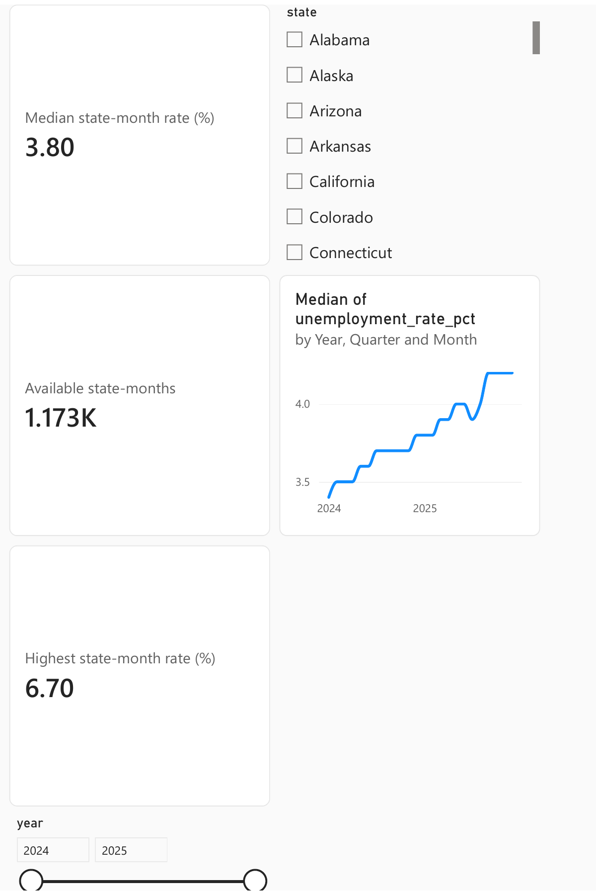
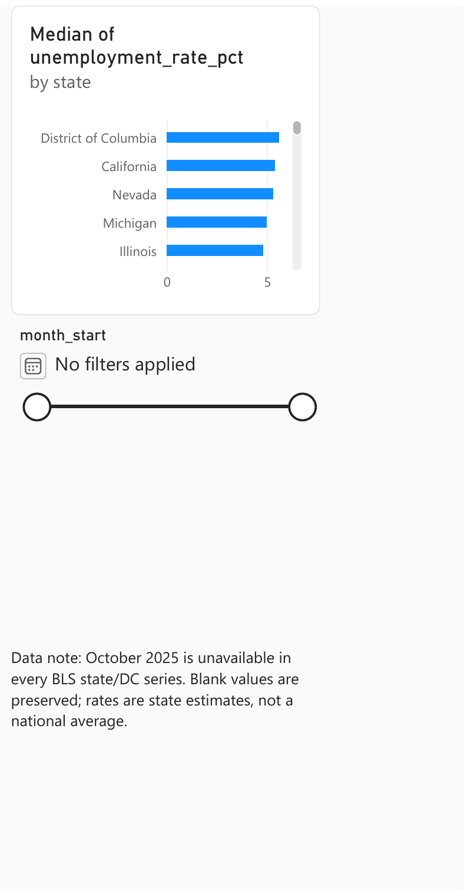

# U.S. State Labor Market | Power BI

An analysis of **seasonally adjusted state unemployment rates and unemployed-person estimates** from the U.S. Bureau of Labor Statistics (BLS) Local Area Unemployment Statistics (LAUS) program. The 2024–2025 panel covers all 50 states and the District of Columbia.

## Business question

How did unemployment rates vary across states in 2024–2025, and which areas changed most by year end? The two-page Power BI report uses KPI cards, state and time filters, a state comparison, and a monthly trend with a year → quarter → month drill hierarchy. Data gaps are shown explicitly.

## Dashboard

[Open the interactive Power BI report](https://app.powerbi.com/groups/me/reports/2b5f224a-1ae8-430a-a7f1-24591afa103e/53ffa3f96377003a04ec?experience=power-bi) (Power BI access may be required) · [Download the two-page PDF](us-state-labor-market-report.pdf)

The report's unfiltered **3.80%** KPI is the median across all available state-month rows in 2024–2025. It differs from the **4.2%** median for December 2025 alone. The available-row KPI shows **1,173**, and the highest observed state-month rate is **6.70%**. Selecting Alabama in the state slicer was checked against the curated data: the report changes to a **2.90%** median, **23** available months, and **3.10%** maximum. The October 2025 gap remains blank.

## Data and validation

- **Source:** [BLS Public Data API](https://www.bls.gov/developers/) using seasonally adjusted state LAUS series. Rate is measure `03` (percent of civilian labor force); unemployed persons is measure `04`.
- **State names and FIPS:** [U.S. Census state reference file](https://www2.census.gov/geo/docs/reference/state.txt).
- **Reproduce:** Run `python build_dataset.py` with Python 3.10+ and network access. It fetches both measures for all 51 jurisdictions and writes the CSV and validation summary. No API key or third-party Python package is needed.
- **Snapshot:** 2026-11-05 UTC. BLS revises historical estimates, so rerunning later may change values.
- **Grain:** One row per state and calendar month, 1,224 rows (51 × 24). There are 1,173 rows with both measures available.
- **Missing data:** October 2025 is unavailable for all 51 jurisdictions in the queried BLS series, with BLS footnote `X` referring to the 2025 lapse in appropriations. Those values remain blank; the CSV has a `data_available` flag.

The rate is already a BLS percentage. It should **not** be averaged across states to produce a national unemployment rate. A median of state rates is used only as a description of the typical state in this panel. Unemployed-person counts must not be summed across months.

## First findings

- The median of the **51 December 2025 state/DC rates** is **4.2%**.
- In December 2025, Hawaii is lowest at **2.2%** and the District of Columbia highest at **6.7%**.
- From December 2024 to December 2025, Colorado has the largest decrease (**−0.5 percentage points**) and Delaware the largest increase (**+1.3 percentage points**) in this snapshot.

These differences describe estimates at two dates; they do not establish a cause or a policy effect. See [findings and caveats](FINDINGS.md) and [machine-readable checks](validation_summary.json).

## Project files

| File | Purpose |
| --- | --- |
| `build_dataset.py` | Reproducible BLS and Census extraction with validation |
| `bls_state_laus_2024_2025.csv` | Curated Power BI input; blank values retain the October gap |
| `validation_summary.json` | Record counts, missingness, and checked KPI values |
| `FINDINGS.md` | Metric definitions, findings, and interpretation limits |
| `us-state-labor-market-report.pdf` | Two-page static export of the interactive report |
| `labor-dashboard-1.png`, `labor-dashboard-2.png` | Dashboard previews for quick review |

## Limitations

BLS LAUS rates are model-based estimates by place of residence, not direct counts of everyone without a job. State estimates are seasonally adjusted and may be revised. Comparing states requires awareness of sampling uncertainty and local labor-market context. The 2025 October gap must not be interpolated as if observed.

